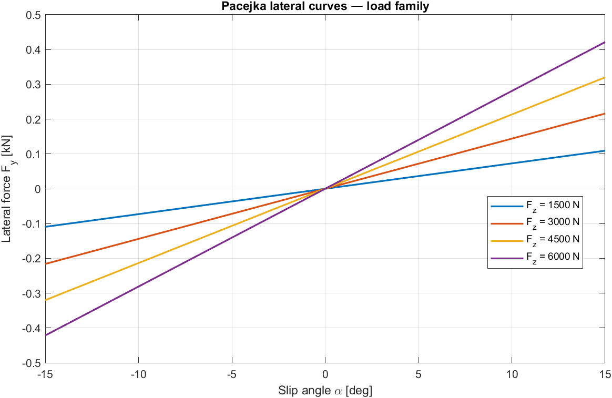
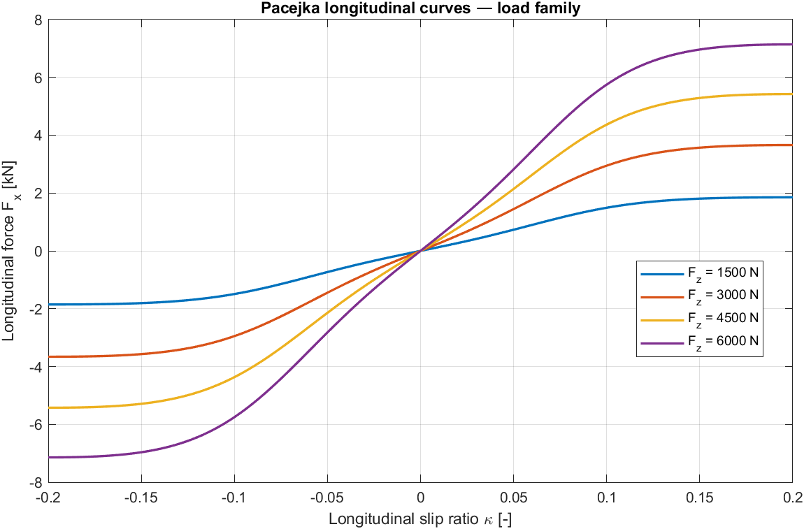
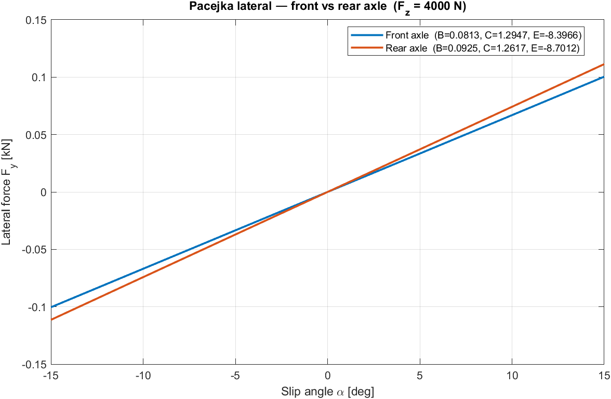
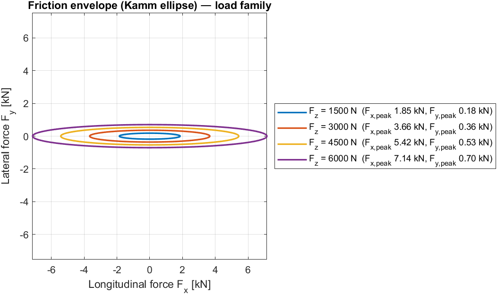

# Pacejka Magic Formula — MATLAB

Clean MATLAB implementation of the Pacejka simplified four-parameter Magic Formula tyre model — lateral and longitudinal — with load-sensitive peak coefficient and a friction-envelope view of combined slip.

Originally implemented during the Vehicle Dynamics Modelling and Simulation course at Hochschule Trier; this repository is a focused standalone extraction of the tyre model used inside both the [vehicle dynamics models toolkit](https://github.com/jaykumarpatil9099/vehicle-dynamics-models-matlab-simulink) (where it sits inside the 14-DoF full-vehicle model) and — planned — the v06 release of the [GT3 Lap Time Simulator](https://github.com/jaykumarpatil9099/gt3-lap-time-simulator), where it will replace the simplified `μ(F_z)` surrogate currently used for QSS calibration.

## What it shows

### Lateral curves — load family

Lateral force `F_y` vs slip angle `α` for four vertical loads. The classic Pacejka shape: linear at zero slip, peaks at a slip-angle around 5–10°, and degrades beyond that. Higher load gives more peak force in absolute terms but lower peak *coefficient* `F_y / F_z` — the degressive friction behaviour every race engineer designs setups around.



### Longitudinal curves — load family

Longitudinal force `F_x` vs slip ratio `κ` for the same loads. Peak occurs at lower slip than lateral (typically κ ≈ 0.10–0.15) and is the basis of traction control and brake balance design.



### Front vs rear axle comparison

Real race tyres are tuned per-axle. The 14-DoF model uses different Magic Formula coefficient sets front and rear (`Cf=1.2947, Bf=0.0813, Ef=-8.3966` vs `Cr=1.2617, Br=0.0925, Er=-8.7012`); this plot at a single representative load shows the resulting asymmetry. A symmetric coefficient set hides the understeer / oversteer balance behaviour the suspension has to deal with.



### Friction envelope

The Kamm-ellipse approximation of combined-slip behaviour: peak `F_x` and peak `F_y` (computed from pure-slip Magic Formula) define an elliptical envelope inside which the tyre can deliver any combination of longitudinal and lateral force. Operating outside the envelope requires more grip than the tyre has at that load.



## Methodology

The simplified four-parameter Pacejka Magic Formula:

```
F = D * sin( C * atan( B*s - E*(B*s - atan(B*s)) ) )
```

with parameters:

| Symbol | Role | Effect |
|---|---|---|
| `B` | Stiffness factor | Slope at zero slip — higher B = stiffer tyre |
| `C` | Shape factor | Peak vs tail shape — typical 1.2–1.6 lateral, 1.4–1.7 longitudinal |
| `D` | Peak force | Maximum force the tyre can produce |
| `E` | Curvature factor | Sharpness around peak — typically negative |

The peak coefficient `D` is load-sensitive:

```
D = (a1 * F_z + a2) * F_z
```

which gives a peak friction coefficient `μ_peak = D / F_z = a1·F_z + a2` that decreases linearly with vertical load — the textbook degressive friction of pneumatic tyres at high `F_z`.

The same formula form drives both axes (lateral with slip angle, longitudinal with slip ratio) using different coefficient sets. Combined slip is approximated by the Kamm ellipse — a textbook simplification that captures the dominant force-trade-off without the inter-axis interaction terms of the full Pacejka 2002 combined-slip model.

## Default coefficients

| Axis | B | C | E | a1 | a2 |
|---|---|---|---|---|---|
| Lateral (single-axle baseline) | 0.1453 | 1.5511 | −2.6166 | −1×10⁻⁵ | 1.25 |
| Longitudinal (driven axle) | 5.7507 | 1.2421 | −6.8251 | −1×10⁻⁵ | 1.25 |
| Lateral — front axle (14-DoF) | 0.0813 | 1.2947 | −8.3966 | −1×10⁻⁵ | 0.95 |
| Lateral — rear axle (14-DoF) | 0.0925 | 1.2617 | −8.7012 | −1×10⁻⁵ | 0.95 |

Lifted directly from the parameter files of the 14-DoF model in the [VD models repo](https://github.com/jaykumarpatil9099/vehicle-dynamics-models-matlab-simulink).

## Engineering note — the load-sensitivity trade-off

Every chassis decision that moves vertical load between tyres (anti-roll bar split, ride height, aero balance, weight distribution) interacts with the degressive friction term. Adding ARB stiffness on one axle redistributes load to the outer tyre on that axle, but the gained outer-tyre force is *less than* the lost inner-tyre force because the outer tyre's `μ_peak` is lower at higher `F_z`. The net axle force drops — and that's why ARB tuning matters for handling balance even though it doesn't change total grip across the car. The same physics underpins lateral-load-transfer modelling in the [VD models 14-DoF](https://github.com/jaykumarpatil9099/vehicle-dynamics-models-matlab-simulink) and the lap simulator's lateral-transfer pass.

## File layout

```
pacejka-tyre-model/
├── parameters.m                     # default coefficients (3 sets)
├── src/
│   ├── pacejka_magic_formula.m      # the F = D sin(C atan(B s ...)) function
│   └── pacejka_peak_value.m         # D = (a1 Fz + a2) Fz
└── figures/
    ├── plot_lateral_curves.m
    ├── plot_longitudinal_curves.m
    ├── plot_axle_comparison.m
    └── plot_friction_envelope.m
```

## Background

Originally implemented during the Vehicle Dynamics Modelling and Simulation course of the M.Sc. Interdisciplinary Engineering (Automotive) programme at [Hochschule Trier](https://www.hochschule-trier.de/). Course is in progress — final assignment outstanding, certificate not yet issued.

## License

MIT. See `LICENSE`.
